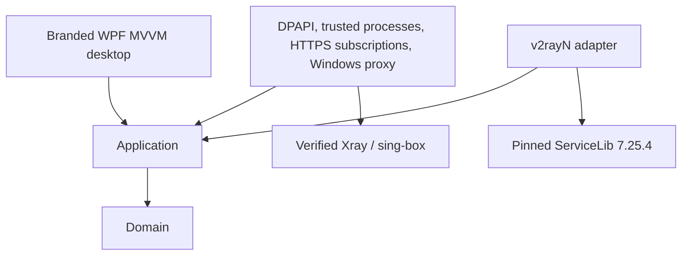
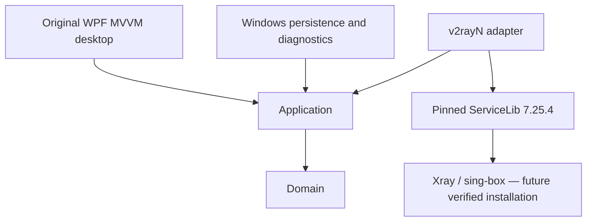

# SHAGHAD architecture — Phase 2

Current implementation: 2026-10-11. The existing solution/projects/internal AJ.VPN namespaces and VPN-AJ data location are retained. No production connectivity claim.

Application owns serialized connection orchestration and LibraryService's atomic snapshot operations. Infrastructure owns DPAPI storage, explicit HTTPS subscription downloads, trusted binary discovery, native process jobs, local readiness/probes and proxy recovery. Only V2RayNAdapter references ServiceLib. Desktop binds actual state without upstream models.

The adapter uses FmtHandler and public single-profile configuration generators with an explicit CoreConfigContext. AppManager storage/lifecycle is never initialized; the user's existing v2rayN installation is untouched. Configurations contain one selected outbound and a loopback mixed HTTP/SOCKS5 listener and must pass native validation before startup. No upstream patches were needed.

The UI labels Connected as **Local proxy ready**. A PID-owned listener and SOCKS5 greeting establish readiness; InternetVerified remains false until an explicit HTTPS probe succeeds through it. Unexpected exit invalidates both facts. Duplicate operations are rejected; startup, version/config checks, downloads and probes have timeouts/cancellation. Normal close restores approved System Proxy settings before stopping owned cores; a kill-on-close job handles abrupt process termination.

Appearance preferences remain atomic JSON. `secrets/library.dpapi` is the bounded Windows-user-encrypted server/subscription store. Failed load disables mutations; failed save/update preserves the previous snapshot. Managed secret strings cannot be reliably zeroized. Cores necessarily receive a private plaintext runtime config, deleted on stop; marked abandoned sessions are cleaned at the next launch. The app allows one instance per data directory.

System Proxy is opt-in current-user WinINet LAN configuration. Confirmation explains PAC/discovery changes and restoration. A durable encrypted journal precedes writes; apply/restore check concurrent changes and preserve absent values/types. Unknown LAN blob formats and machine/policy restrictions fail closed. Registry operations are not an atomic cross-process transaction. Native WinINet effects and policy variants still require validation with explicit user approval. RAS, WinHTTP, system DNS/routes and TUN are not managed.

Only explicit actions fetch subscriptions or probe HTTPS; startup does not change networking, install drivers, elevate or download cores. Executable trust is anchored in the compiled manifest and checked by hash/version. The app is unsigned: pinning cannot protect against replacement of the entire application. Native licenses accompany installed/published binaries.

Concept C, themes, Vazirmatn and English/Persian layout are preserved. Real imports, selection, endpoint, subscription updates, HTTPS latency and local diagnostics replace foundation placeholders. Traffic/public IP, advanced routing, autostart, TUN and automatic selection are deferred; dynamic errors/options are partly English. Executable: `Shaghad.exe`; there is no installer. See `D:/VPN-AJ/docs/testing/VALIDATION.md`.

## Historical foundation decisions

The following describes the original foundation before Phase 2; current behavior is documented above.

Decision date: 2026-10-11. Foundation milestone; no production connectivity claim.

Domain owns connection states, server metadata and settings, without Windows references. Application owns contracts and serialized connection orchestration. Infrastructure owns atomic versioned settings persistence and sanitized operational logging. The adapter is the only VPN-AJ project referencing ServiceLib. Desktop composes services through Microsoft dependency injection and binds view models; it never references upstream models.

Do not initialize AppManager in the UI: upstream storage is executable-relative or `%LOCALAPPDATA%/v2rayN`, not VPN-AJ. Its initialization creates SQLite tables and its exit routine force-clears proxy settings. A storage-path seam and ownership-aware proxy wrapper are prerequisites for core activation. Initial integration uses upstream profile parsing only; invalid input must be rejected before it reaches parsers which can log exceptions.

Connection states: Disconnected → Connecting → Connected → Disconnecting → Disconnected; failures → Error; retry from Error is allowed. Connected requires an explicit readiness result, and the UI must distinguish core readiness from internet verification. The foundation backend reports unavailable and never simulates success. Concurrent operations are rejected; cancellation returns to a safe state. No startup networking changes, drivers, elevation, telemetry or automatic downloads.

Persist only non-secret settings in schema-versioned JSON initially, using atomic replacement. SQLite becomes justified when real server/subscription CRUD is implemented. Secrets need user-bound DPAPI and a separate store. Provider subscription updates must stage and validate before transactional replacement; raw URLs never enter diagnostic messages.

Unavailable pages show why they are unavailable. Close means exit in this milestone. SHAGHAD branding adds a presentation-only tray icon with Open/About/Exit; startup registration, proxy ownership and crash recovery remain separate integration work. Built-in WPF controls preserve keyboard and UI Automation behavior; semantic tokens support light/dark/system themes. Persian resources provide RTL with explicit LTR technical fields and bundled OFL Vazirmatn. Desktop output is Shaghad.exe; internal AJ.VPN namespaces, project names and the existing VPN-AJ data path remain unchanged. See docs/design/BRANDING-INTEGRATION.md.
