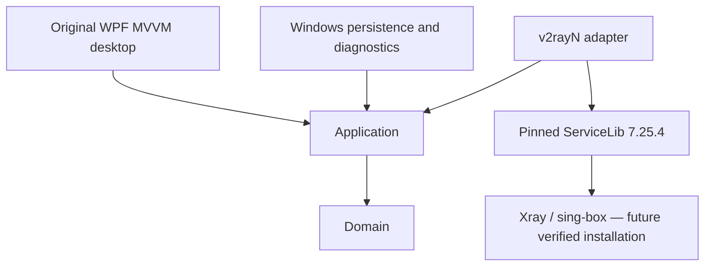

# VPN-AJ architecture

Decision date: 2026-10-11. Foundation milestone; no production connectivity claim.

Domain owns connection states, server metadata and settings, without Windows references. Application owns contracts and serialized connection orchestration. Infrastructure owns atomic versioned settings persistence and sanitized operational logging. The adapter is the only VPN-AJ project referencing ServiceLib. Desktop composes services through Microsoft dependency injection and binds view models; it never references upstream models.

Do not initialize AppManager in the UI: upstream storage is executable-relative or `%LOCALAPPDATA%/v2rayN`, not VPN-AJ. Its initialization creates SQLite tables and its exit routine force-clears proxy settings. A storage-path seam and ownership-aware proxy wrapper are prerequisites for core activation. Initial integration uses upstream profile parsing only; invalid input must be rejected before it reaches parsers which can log exceptions.

Connection states: Disconnected → Connecting → Connected → Disconnecting → Disconnected; failures → Error; retry from Error is allowed. Connected requires an explicit readiness result, and the UI must distinguish core readiness from internet verification. The foundation backend reports unavailable and never simulates success. Concurrent operations are rejected; cancellation returns to a safe state. No startup networking changes, drivers, elevation, telemetry or automatic downloads.

Persist only non-secret settings in schema-versioned JSON initially, using atomic replacement. SQLite becomes justified when real server/subscription CRUD is implemented. Secrets need user-bound DPAPI and a separate store. Provider subscription updates must stage and validate before transactional replacement; raw URLs never enter diagnostic messages.

Unavailable pages show why they are unavailable. Close means exit in this milestone. SHAGHAD branding adds a presentation-only tray icon with Open/About/Exit; startup registration, proxy ownership and crash recovery remain separate integration work. Built-in WPF controls preserve keyboard and UI Automation behavior; semantic tokens support light/dark/system themes. Persian resources provide RTL with explicit LTR technical fields and bundled OFL Vazirmatn. Desktop output is Shaghad.exe; internal AJ.VPN namespaces, project names and the existing VPN-AJ data path remain unchanged. See docs/design/BRANDING-INTEGRATION.md.
