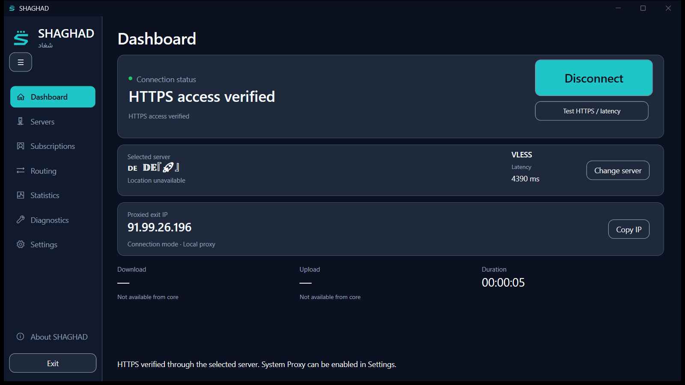
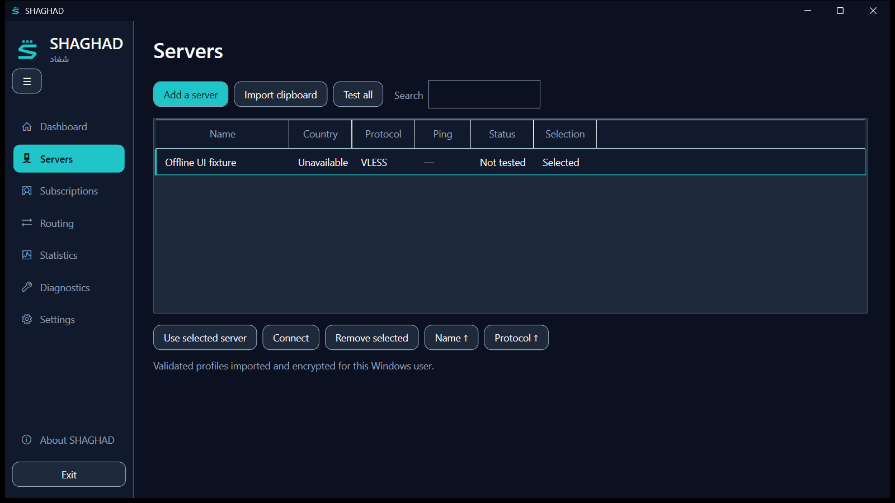
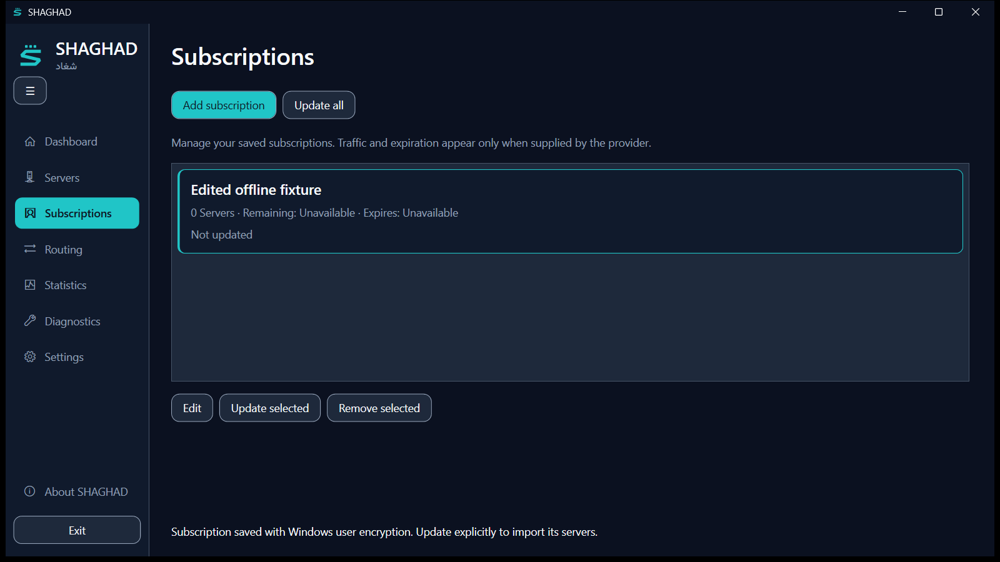

# SHAGHAD premium UI redesign

Date: 2026-10-11 (Asia/Tehran). Project: D:\VPN-AJ.

## Original problems

The previous dashboard emphasized engine and listener details, replaced Connect with Add Server in the empty state, and omitted public IP and session information. Servers and subscriptions were dominated by permanent input forms. The wide sidebar and development subtitle made the application feel like an administrative utility. Native Windows chrome remained white in the dark theme.

## Experience and design

The dashboard prioritizes a large Connect/Disconnect action, then selected server, protocol, measured HTTPS latency and proxied exit IP. Download and upload honestly show unavailable values because the backend exposes no traffic counters. Duration measures the actual running session.

Connect remains visible and disabled without an imported server. An adjacent Add Server action opens an editor. Connecting shows actual operation progress; cancellation uses the existing disconnect workflow. Gray, turquoise, amber and green indicators distinguish disconnected, starting, locally ready/unverified and HTTPS-verified states. Local process readiness never implies verified internet access.

The navy/turquoise identity, Segoe UI and embedded Vazirmatn are preserved. Compact bordered surfaces and a 184-DIP sidebar replace the oversized shell. Navigation collapses to 68 DIPs with icons and tooltips. The shell and native controls remain LTR; localized text uses RTL islands. Close stays at the native top-right position. DWM APIs update supported Windows caption colors while preserving native controls.

Dashboard notices use one line with a full-text tooltip. Long server names use ellipsis with a full-name tooltip. This prevents transient notices and provider-controlled names from pushing connection controls offscreen. The hero becomes more compact after a server is selected.

Servers use a toolbar, searchable/filterable GridView, protocol/name sorting, explicit selection, connect, removal and Test All. Columns show name, supplied country, protocol, real measured ping, test status and active selection. Unavailable country or latency remains unavailable. Test All starts/stops each real proxy sequentially, measures HTTPS through it, and restores the original selection.

Subscriptions use a management list with add, update-all, edit, update and remove actions. Add/edit are dedicated dialogs. Cards show server count, last successful update and optional provider-reported traffic and expiration. The subscription-userinfo header is validated for missing/malformed fields and overflow, then saved atomically with profiles. Unlimited/absent totals and absent expiration remain unavailable. Changing a subscription URL clears metadata belonging to the old URL.

Core selection, executable/version details, local endpoint, proxy approval/restoration, diagnostics, licenses and About remain accessible outside the dashboard.

## Public-IP behavior

PublicExitIp requests https://api64.ipify.org through the active loopback SOCKS5 listener, with https://api.ipify.org as a second trusted proxied endpoint if the first is unavailable. There is no direct fallback or direct-IP lookup. The UI labels this value **Proxied exit IP**; it is not a measured Direct Public IP and does not claim the IP changed compared with a direct connection.

Default platform certificate-chain and hostname validation remain enabled. Requests have a 10-second overall timeout and a 4-second budget per endpoint, caller cancellation, no cookies/redirects and a bounded response. IPv4/IPv6 responses are parsed; malformed, loopback and unspecified results are rejected. Failure displays an em dash and disables Copy IP. Disconnect, cancellation, core exit and changed listener ownership invalidate session results.

HTTPS verification and IP availability remain separate. Verified HTTPS can coexist with an unavailable IP endpoint. A repeated live run exercised this condition: HTTPS remained verified while the IP endpoint temporarily failed; the UI correctly showed no IP and disabled Copy.

## Architecture and data

Application services still own connection and encrypted-library changes. Infrastructure owns HTTPS/proxy requests, Windows proxy restoration and secure storage. Presentation row wrappers own formatting/filtering/selection; domain objects contain no WPF/UI state. Optional subscription metadata uses backward-compatible nullable defaults.

Smoke/live runners use fresh private test storage. The production encrypted library, saved appearance preferences and Windows System Proxy were not changed. The supplied profile was passed through a process environment variable and imported into isolated encrypted storage; its share URI was never embedded in source, screenshot reports or documentation.

## Changed implementation files

| Area | Files |
| --- | --- |
| Shell/dashboard | apps/windows/AJ.VPN.Desktop/MainWindow.xaml, MainWindow.xaml.cs, App.xaml.cs |
| Styles/localization | Styles/ShaghadDesignSystem.xaml, Resources/English.xaml, Resources/Persian.xaml |
| View state/commands | ViewModels/ShellViewModel.cs, ViewModels/ShellViewModel.Premium.cs |
| Subscription edits/metadata | src/AJ.VPN.Application/LibraryService.cs, Contracts.cs, src/AJ.VPN.Domain/Models.cs, src/AJ.VPN.Infrastructure/SubscriptionDownloader.cs |
| Exit-IP measurement | src/AJ.VPN.Infrastructure/PublicExitIp.cs |
| Actual WPF validation | apps/windows/AJ.VPN.Desktop/SmokeTest.cs, PremiumLiveTest.cs |
| New regression tests | tests/AJ.VPN.IntegrationTests/PublicExitIpTests.cs, SubscriptionMetadataTests.cs |
| Packaging | scripts/publish.ps1: optional output directory, previous default preserved |

Other pre-existing/concurrent connection, adapter and core-audit changes in the workspace were preserved.

## Build and tests

Release publication succeeded for Windows x64/.NET 10. Output: artifacts/shaghad-premium/. Build log: artifacts/premium-publish.log. Pinned Xray/sing-box binaries and legal/font notices are included. SHA-256 hashes: artifacts/premium-sha256.json.

- Unit suite: 3 passed.
- Integration suite: 89 passed, including existing regressions and new IP/metadata checks.
- WPF smoke: eight pages, embedded font, ICO frames, tray callbacks and license viewer.
- 32 shown-window layout checks: four sizes × two themes × two languages × Dashboard/About. No dashboard overflow, overlapping cards, clipped text or mirrored shell.
- Management: real import, selection, filter/reset, sorting, subscription add/edit/remove and server removal in isolated storage.
- Unreachable-profile check: real core readiness, failed HTTPS verification, no exit IP/false success, disconnect cleanup.
- Native captures: caption controls, compact navigation and both editors.

TRX files: artifacts/PremiumTestResults/. An expanded TLS fixture initially hit its short cancellation deadline during a concurrent suite update; its deadline was corrected and the full current suite passed. Machine-readable UI evidence: screenshots/layout-results.json, management-results.txt and result.txt.

## Live verification

A reachable profile explicitly supplied by the user was imported without changing its protocol/encryption. Xray startup, TLS-verified HTTPS through the active proxy, actual public exit IP and Copy IP passed. Disconnect cleared IP, latency and duration.

Verified connection layouts were checked at 1024×600, 1280×720, 1366×768 and 1920×1080 in English/Persian and Light/Dark. The final packaged build passed HTTPS, IP measurement, copying and cleanup; all 16 connected-state checks have zero scrollable height. Earlier intermittent failures are retained separately under screenshots/live/. Evidence: screenshots/live-final/live-results.json. This verifies the supplied profile at test time, not universal provider availability.

System Proxy was left unchanged during automated verification. Its approval, journal and restoration functionality remains covered by integration tests.

## Actual screenshot evidence

All images come from the real WPF app. Native screenshots use Windows PrintWindow; page/matrix images use WPF RenderTargetBitmap from shown windows. No generated images or simulated network statistics were used. Offline fixtures are clearly named and use example.invalid.

| Evidence | Files under screenshots/ |
| --- | --- |
| Empty dashboards | Dashboard-dark.png, Dashboard-persian.png |
| Populated managers | Servers-native.png, Subscriptions-native.png (labelled offline fixtures) |
| Compact navigation | Dashboard-compact-native.png |
| Editors | Import-dialog-native.png, Subscription-dialog-native.png |
| Core/progress safety | Dashboard-connecting-native.png, Dashboard-unverified-native.png |
| Disconnected matrix | native-layout-*.png |
| Actual verified connection | live-final/Live-result.png |
| Connected matrix | live-final/Live-*-Light.png, live-final/Live-*-Dark.png |
| Disconnect cleanup | live-final/Live-disconnected.png |

## Publication and reproduction

The complete portable package is artifacts/SHAGHAD-Premium-win-x64.zip. Extract it and keep the folder contents together.

Launch D:\VPN-AJ\artifacts\shaghad-premium\Shaghad.exe from its complete folder. This framework-dependent x64 publication requires the .NET 10 Windows Desktop runtime. Close an older SHAGHAD instance before normal startup.

Rebuild:

    ./scripts/publish.ps1 -OutputDirectory artifacts/shaghad-premium

Launch the published smoke harness with the installed/bundled .NET host:

    ./.tools/dotnet/dotnet.exe artifacts/shaghad-premium/Shaghad.dll --smoke-test docs/design/screenshots

Live verification is opt-in through --premium-live-test and needs a user-authorized profile in the process-only SHAGHAD_PREMIUM_PROFILE variable. Never commit a profile or log its URI.

## Remaining limitations

- Throughput is unavailable because the backend has no traffic telemetry. No simulated counters are shown.
- Country appears only when supplied in profile metadata; names/flags are not verified location evidence.
- There is no direct-IP comparison, so a proxy IP is not claimed to differ from the direct public IP.
- TUN and advanced routing remain outside existing backend capabilities.
- One supplied live profile was verified. Real IPv6 exit connectivity and provider traffic-header downloads were not available for end-to-end checks; IPv6 parsing and malformed metadata are test covered.
- System Proxy requires existing explicit in-app approval. Live tests made no proxy-setting changes.
- Native dragging/snapping and manual keyboard interaction are not certified by captures/style-bit checks.
- This publication has no signed installer or production release certification.

## Follow-up review

The repeated requirements review corrected server column/sort labels, test states and subscription metadata localization. Language changes refresh presentation rows. Selected server rows now use themed backgrounds and turquoise borders instead of the Windows default gradient, preserving readable contrast in dark mode. The rebuilt package passed 3 unit tests, 89 integration tests and the full WPF smoke/layout/management checks. Fresh actual Persian manager screenshots are Servers-persian-native.png and Subscriptions-persian-native.png. The existing live-final evidence records the earlier successful live network run; this follow-up changed presentation only and did not repeat that external network test.

